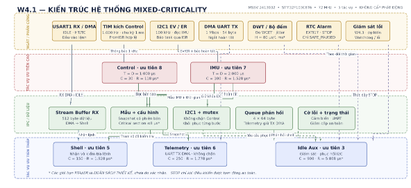

# W4.1 — TÀI LIỆU THIẾT KẾ HỆ THỐNG MIXED-CRITICALITY

**Bản đề xuất gửi mentor đánh giá — Phiên bản 1.1** **Trạng thái:** CHỜ PHÊ DUYỆT — chưa phải kết quả kiểm thử phần cứng

**Mã số sinh viên:** 2413032 **Phần cứng:** STM32F103C8T6 · Cortex-M3 · 72 MHz · SRAM 20 KiB **Hệ điều hành:** FreeRTOS Kernel v11 **Ràng buộc:** Không HAL/LL/CMSIS-OS; không cấp phát động trong W4.2; ở W4.1 chỉ thiết kế, chưa viết thân task/ISR/driver.

**Nội dung cần mentor phê duyệt:** (1) các ngân sách WCET và giả định để áp dụng RTA; (2) chế độ STOP chỉ khi đã tạm dừng điều khiển an toàn (SAFE_PAUSED); (3) cơ chế hủy giao dịch I2C trong giới hạn µs thay cho timeout 35 ms cũ. Mọi giá trị có dấu `*` trong tài liệu là *giới hạn đề xuất, chưa đo và xác nhận*.

**Nguyên tắc ưu tiên:** Control > IMU > Telemetry > Shell > Idle Aux. Control không chờ mutex I2C, UART, DMA, cũng không vào critical section dài. Hệ thống gồm năm task ứng dụng và FreeRTOS Idle Task; không cần Timer Service Task nếu configUSE_TIMERS=0.

## 1. MÔ HÌNH TÁC VỤ VÀ KIẾN TRÚC HỆ THỐNG

| **Task**  | **Nguồn kích hoạt**                                           | **T (µs)** | **D (µs)** | **C CPU đề xuất (µs)** | **Priority** | **Chính sách thực thi**                                                                                                 |
|-----------|---------------------------------------------------------------|------------|------------|------------------------|--------------|-------------------------------------------------------------------------------------------------------------------------|
| Control   | Ngắt TIM 1 kHz → Notification trực tiếp                       | 1.000      | 1.000      | **30**                 | **8**        | Đọc bản sao dữ liệu IMU, chạy điều khiển P, kiểm tra tuổi mẫu; nếu lỗi hoặc >5 ms thì đưa về đầu ra 0 (đang xin duyệt) |
| IMU       | Chu kỳ 2 ms                                                   | 2.000      | 2.000      | **100**                | **7**        | Một giao dịch đọc 6 bytes; hoàn tất hoặc báo dữ liệu không hợp lệ trong giới hạn thời gian                              |
| Telemetry | Chu kỳ TX DMA                                                 | 38.462     | 38.462     | **250**                | **6**        | Chụp trạng thái, gửi khung 54 bytes; nghẽn thì bỏ/hoãn, không chặn Control                                              |
| Shell     | Lệnh phát sinh; giới hạn nhận vào 1 lệnh/50 ms                | 50.000†    | 50.000     | **150**                | **5**        | Parse tối đa 32 ký tự; timeout lệnh chưa hoàn chỉnh 198 ms                                                              |
| Idle Aux  | Server mỗi 100 ms; lỗi có thể đánh thức sớm nhưng dồn yêu cầu | 100.000    | 100.000    | **900**                | **3**        | Theo dõi trạng thái và thực hiện recovery I2C theo bước, giới hạn CPU mỗi 100 ms                                        |

† Shell là tác vụ sporadic, có **khoảng cách đến tối thiểu giữa hai lệnh được nhận xử lý 50 ms**; không phải timer định kỳ. Trong header period_us = 0 và hằng riêng biểu thị giới hạn 50 ms. C_idle_aux = 900 µs là ngân sách CPU cho nhánh lỗi trong một lượt server; không có nghĩa timeout 35 ms cũ chỉ tiêu tốn 900 µs.

### 1.1. SƠ ĐỒ KIẾN TRÚC BỐN TẦNG — LUỒNG TÁC VỤ VÀ TÀI NGUYÊN

Hình 1 — Mô hình 4 tầng: ngắt/phần cứng (vàng) → tác vụ ưu tiên cao (đỏ) → IPC tĩnh (xanh lá) → tác vụ nền (xanh dương). 

**Hình 1.** Sơ đồ bốn tầng được vẽ theo phong cách tham khảo của mentor: tầng ngắt/phần cứng (vàng), tác vụ ưu tiên cao (đỏ), IPC/bộ nhớ tĩnh (xanh lá), tác vụ nền/ưu tiên thấp (xanh dương). Các mũi tên liền là luồng dữ liệu/thông báo; mũi tên nét đứt là giám sát hoặc luồng lỗi/phục hồi. Sơ đồ thể hiện **phương án thiết kế**, không khẳng định toàn bộ phần tử đã triển khai.

### 1.2. Phân tích giao dịch IMU

- **Tốc độ I2C1 là 100 kHz.** Một giao dịch ghi địa chỉ thanh ghi rồi đọc 6 bytes cần khoảng **ít nhất 81 xung SCL**, tương đương **≥810 µs trên đường truyền**, chưa tính START/STOP và phần mềm. Vì vậy R_IMU = 130 µs ở PREDICTION ban đầu không đại diện cho response time hoàn tất đọc IMU.

- **Ngân sách mới:** C_IMU = 100 µs là thời gian sử dụng CPU; S_IMU = 1.200 µs là giới hạn thời gian chờ giao dịch hoặc hủy có kiểm soát. Trong phép RTA bảo thủ, coi E_IMU = C_IMU + S_IMU = 1.300 µs là nhu cầu thực thi tương đương. Việc tính cả thời gian suspend như đang chiếm CPU là cách chặn trên bi quan cho những task ưu tiên thấp.

- **Điều kiện nghiệm thu:** mỗi job IMU phải kết thúc bằng mẫu mới **hoặc** trạng thái lỗi rõ ràng trước hạn. W4.2 cần thêm timeout/hủy mức microsecond; không dùng timeout ulTaskNotifyTake 35 ms. Notification cũ phải được xóa hoặc gắn ID giao dịch để tránh nhận nhầm.

- **Trường hợp bus lỗi:** nếu mutex không lấy được ngay, I2C báo lỗi hoặc giao dịch quá hạn, IMU cập nhật INVALID, gửi yêu cầu cho Idle Aux; IMU **không đợi phục hồi**. Chu kỳ lấy mẫu 500 Hz vẫn duy trì, nhưng trong giai đoạn cảm biến lỗi có thể không sinh mẫu hợp lệ.

- **Giới hạn áp dụng:** giả định không có clock stretching vô hạn, không trì hoãn ISR vô hạn và không chờ mutex đang được recovery giữ. Nếu đo thực tế vượt S_IMU = 1.200 µs, bắt buộc thay đổi driver/tốc độ I2C/kiến trúc và chạy lại RTA.

### 1.3. Sở hữu dữ liệu và cơ chế đồng bộ

- **TIM ISR:** đánh thức Control bằng vTaskNotifyGiveFromISR; cấu hình NVIC với mức ưu tiên hợp lệ để gọi FreeRTOS API trong ngắt (giá trị ưu tiên CMSIS ≥5 với cấu hình hiện tại).

- **Control:** đọc snapshot phiên bản hóa trong critical section rất ngắn; điều khiển P và cập nhật đầu ra. Không printf, không gọi API I2C/UART và không chờ mutex.

- **IMU:** chỉ một client I2C hoạt động ở trạng thái ACTIVE; thử lấy mutex không chờ, dùng ngắt I2C và notification; cập nhật atomically mẫu + dấu thời gian.

- **Idle Aux:** chỉ chiếm bus khi transaction trước đã bị abort, bus không còn hoạt động; recovery chia thành các bước có thể bị preempt; gộp yêu cầu lỗi và giới hạn CPU 900 µs/100 ms.

- **USART1 RX:** circular DMA và các ngắt IDLE/HT/TC → một Stream Buffer; Shell là **consumer duy nhất**. Parser khung nhị phân W3.1 và parser text Shell là hai chế độ của cùng luồng dữ liệu, không cho hai task cùng đọc Stream Buffer.

- **USART1 TX:** Telemetry sở hữu DMA TX; Shell đặt phản hồi vào Queue tĩnh. Buffer nguồn TX phải ổn định đến khi DMA báo hoàn tất.

- **Trạng thái dùng chung:** snapshot có phiên bản hoặc critical section khóa ngắt với ngân sách ≤8 µs`*`; không dùng mutex blocking trong luồng Control.

## 2. PHÂN TÍCH RESPONSE TIME (RTA) — CHỨNG MINH CÓ ĐIỀU KIỆN

### 2.1. Giả định tính toán

**A1 — Scheduler và ngắt:** một lõi, ưu tiên cố định có preemption, thứ tự [8, 7, 6, 5, 3]. Trong mọi cửa sổ trượt 1.000 µs, tổng thời gian gây nhiễu của ISR và chuyển ngữ cảnh được giới hạn H = 80 µs`*`. Cận này bao gồm TIM, I2C EV/ER, UART DMA/IDLE, SysTick và chi phí dispatch; phải kiểm tra khi hệ thống chịu tải và UART flood.

**A2 — Blocking:** critical section không thể preempt lớn nhất B = 8 µs`*`, chưa cộng trùng với H. Nếu vượt 8 µs thì phải cập nhật RTA và độ trễ kích hoạt Control.

**A3 — WCET CPU:** lần lượt [30, 100, 250, 150, 900] µs`*` cho Control, IMU, Telemetry, Shell, Idle Aux (nhánh lỗi). Đây là **ngân sách cần đo xác nhận**. UART flood phải được giới hạn xử lý để không phá vỡ H; recovery I2C không được tắt ngắt suốt một chu kỳ phục hồi.

**A4 — Chờ I2C:** mỗi job IMU có S_IMU = 1.200 µs`*` cho hoàn tất/abort; RTA dùng E_IMU = 1.300 µs, còn CPU utilization chỉ tính C_IMU = 100 µs vì thời gian chờ không liên tục chiếm CPU.

**A5 — Giới hạn admission:** Shell xử lý tối đa một lệnh/50 ms; Idle Aux có tối đa một lượt ngân sách recovery CPU 900 µs trong 100 ms. Phần recovery chưa làm xong được hoãn sang lượt tiếp theo, dữ liệu IMU vẫn mang trạng thái không hợp lệ cho đến khi bus khỏe lại.

Công thức lặp RTA cho task i (mô hình chặn trên bảo thủ):

**Rᵢ⁽ᵏ⁺¹⁾ = Eᵢ + Bᵢ + ⌈Rᵢ⁽ᵏ⁾/1000⌉ × 80 + Σ(j có priority cao hơn i) ⌈Rᵢ⁽ᵏ⁾/Tⱼ⌉ × Eⱼ**

Lấy E = [30, 1300, 250, 150, 900] µs, Bᵢ = 8 µs, T = [1000, 2000, 38462, 50000, 100000] µs. Bắt đầu với Rᵢ⁽⁰⁾ = Eᵢ + Bᵢ; lặp đến khi hội tụ hoặc vượt deadline.

### 2.2. Kết quả lặp và WCRT dự đoán

| **Task**             | **Dãy lặp R (µs)**                          | **R hội tụ (µs)** | **D (µs)** | **Dư thời gian D−R (µs)** | **Theo mô hình** |
|----------------------|---------------------------------------------|-------------------|------------|---------------------------|------------------|
| Control              | 38 → 118 → 118                              | **118**           | 1.000      | 882                       | Đạt`*`            |
| IMU                  | 1.308 → 1.528 → 1.528                       | **1.528**         | 2.000      | 472                       | Đạt`*`            |
| Telemetry            | 258 → 1.668 → 1.778 → 1.778                 | **1.778**         | 38.462     | 36.684                    | Đạt`*`            |
| Shell                | 158 → 1.818 → 1.928 → 1.928                 | **1.928**         | 50.000     | 48.072                    | Đạt`*`            |
| Idle Aux — nhánh lỗi | 908 → 2.718 → 4.238 → 5.758 → 5.868 → 5.868 | **5.868**         | 100.000    | 94.132                    | Đạt`*`            |

Task sát deadline nhất theo margin tuyệt đối là **IMU: 472 µs**. Ngân sách dự kiến cho độ trễ từ IRQ đến khi Control được chạy là H + B ≤ 88 µs`*`, thấp hơn mức jitter cho phép 109 µs, còn dư 21 µs. Đây chỉ là **phân bổ thiết kế**, cần đo riêng; R_Control = 118 µs là thời gian đáp ứng từ release đến hoàn thành, không phải jitter.

**Giải thích chọn priority:** nếu đặt IMU cao hơn Control, mô hình bảo thủ có thể khiến Control chịu thêm đến E_IMU = 1.300 µs interference, nên không chứng minh được deadline 1 ms. Lập luận chỉ áp dụng cho mô hình và các ngân sách hiện tại, không kết luận mọi hoán vị khác đều sai trong mọi trường hợp.

### 2.3. Ảnh hưởng của bus recovery và UART flood

- **Bus recovery:** W2.1 mất khoảng 36 ms từ lúc gây lỗi tới lúc trả về, chủ yếu vì timeout cũ 35 ms. Đường này không được chặn Control/IMU. Khi thất bại, IMU phải trả trạng thái lỗi trong giới hạn 1.200 µs rồi để Idle Aux phục hồi bất đồng bộ.

- **Idle Aux:** giới hạn CPU 900 µs mỗi 100 ms trong nhánh lỗi, vẫn có thể bị preempt. RTA đã dùng giá trị 900 thay cho C bình thường 15 µs trong PREDICTION.

- **UART flood:** RX có thể làm tổng ISR vượt ngân sách 80 µs/1 ms nếu không giới hạn; thiết kế cần rút ngắn ISR, giảm/che bớt ngắt RX IDLE khi quá tải nhưng vẫn quản lý DMA đúng, đếm số khung bỏ và bảo toàn deadline tác vụ quan trọng. Không cam kết Shell nhận không mất byte dưới flood tùy ý.

## 3. NGÂN SÁCH CPU

CPU utilization tính theo thời gian **thực sự chiếm CPU**, không cộng S_IMU = 1.200 µs như một tải CPU liên tục.

| **Thành phần**                               | **Phép tính** | **Ngân sách CPU (%)** |
|----------------------------------------------|---------------|-----------------------|
| Control                                      | 30/1.000      | 3,0000                |
| IMU                                          | 100/2.000     | 5,0000                |
| Telemetry                                    | 250/38.462    | 0,6500                |
| Shell                                        | 150/50.000    | 0,3000                |
| Idle Aux — nhánh lỗi                         | 900/100.000   | 0,9000                |
| **Tổng CPU các task**                        |               | **9,8500**            |
| Ngân sách ISR và chuyển ngữ cảnh             | 80/1.000      | **8,0000**            |
| **Tổng tải CPU dự kiến tối đa theo mô hình** |               | **17,8500**           |
| **Giới hạn theo đề**                         |               | **81,0000**           |

Phần dự phòng dự kiến là **63,15 điểm phần trăm** với điều kiện các ngân sách được kiểm chứng. CPU load W3.1 ~1,82% thuộc workload khác và không thể dùng thay cho giới hạn W4.1. Cần đo riêng CPU ISR và các task trong W4.3.

## 4. NGÂN SÁCH SRAM TĨNH — KHÔNG DÙNG HEAP

Đơn vị byte; stack của task cấp phát theo word 32-bit. Các giá trị TCB/Queue/kernel là **khoản dự phòng để thiết kế**, không tuyên bố đúng sizeof() cho mọi phiên bản compiler. Phải dùng linker map để xác nhận.

| **Hạng mục**                      | **Dự phòng (bytes)** | **Cơ sở**                             |
|-----------------------------------|----------------------|---------------------------------------|
| Stack Control                     | 1.024                | 256 words                             |
| Stack IMU                         | 1.280                | 320 words                             |
| Stack Telemetry                   | 1.024                | 256 words                             |
| Stack Shell                       | 1.024                | 256 words                             |
| Stack Idle Aux                    | 768                  | 192 words                             |
| Stack FreeRTOS Idle Task          | 512                  | 128 words                             |
| Sáu TCB/StaticTask_t              | 768                  | 6 × 128 bytes dự phòng                |
| MSP stack cho main/ISR            | 1.024                | Linker 0x400                          |
| Circular DMA RX USART1            | 256                  | Tái dùng W3.1                         |
| Vùng nhớ Stream Buffer RX         | 513                  | 512 bytes dữ liệu + 1 byte dự phòng   |
| Buffer DMA TX USART1              | 256                  | Cố định trong lúc DMA đang truyền     |
| Bộ nhớ Queue phản hồi Shell       | 256                  | 4 × 64 bytes                          |
| Đối tượng điều khiển StaticQueue  | 128                  | Dự phòng giới hạn trên                |
| Đối tượng mutex I2C tĩnh          | 128                  | Dự phòng giới hạn trên                |
| Trạng thái giao dịch I2C          | 192                  | Bộ nhớ driver tĩnh                    |
| Mẫu IMU + config + cờ lỗi         | 256                  | Snapshot, gain, timestamp, trạng thái |
| Bộ đệm dòng lệnh Shell            | 64                   | Tối đa 32 ký tự + phần quản lý        |
| Tracer / bộ đếm runtime           | 512                  | Phục vụ kiểm thử W4.3                 |
| Biến hệ thống kernel / danh sách  | 512                  | Dự phòng .bss                         |
| RTC và tickless state             | 256                  | Counter và khôi phục clock            |
| Biến .data/.bss khác              | 1.024                | Board/support/peripheral              |
| Dự phòng căn chỉnh / chưa phân bổ | 511                  | Headroom                              |
| **TỔNG DỰ PHÒNG RAM**             | **12.288**           | **≤16.114**                           |

**RAM còn dư: 3.826 bytes.** So với PREDICTION ban đầu 11.776 bytes, thiết kế mới tăng dự phòng 512 bytes để thể hiện các khoản trước đó chưa phân tách. Khi build W4.2, dùng linker map xác định chính xác .data + .bss + các vùng tĩnh + MSP, tránh tính trùng MSP. Nếu không dùng dynamic allocation, không để vùng heap_4 8 KiB (ucHeap) tiếp tục chiếm RAM; dùng cấu hình APP_STATIC=1, configSUPPORT_DYNAMIC_ALLOCATION=0, đồng thời kiểm tra .map và pvPortMalloc.

Sau khi chạy W4.2 cần so stack high-water mark với dự toán và mức dung sai 11 words theo W4E2. Stack ISR tính riêng với các stack task.

## 5. BẢNG PHÂN TÍCH LỖI VÀ PHẢN ỨNG AN TOÀN

| **Tài nguyên / lỗi**                       | **Cách phát hiện**                                                      | **Thành phần phụ trách**    | **Cách xử lý / giảm cấp**                                                                                |
|--------------------------------------------|-------------------------------------------------------------------------|-----------------------------|----------------------------------------------------------------------------------------------------------|
| IMU mất kết nối, I2C SDA kẹt LOW           | Không hoàn tất trước 1.200 µs; cờ bus lỗi; mẫu cũ >5 ms                | IMU, Control                | Abort; đánh dấu mẫu INVALID; Control đưa đầu ra về 0 (chờ duyệt); Idle Aux thực hiện recovery không chặn |
| Recovery I2C không hoàn tất, lỗi liên tiếp | Bus không trở về IDLE; hết ngân sách phục hồi mỗi lượt                  | Idle Aux / bộ giám sát      | Giữ cờ BUS_FAULT, giới hạn số lần retry, báo trạng thái; không block tác vụ ưu tiên cao                  |
| UART flood hoặc ngắt quá dày               | ISR chiếm >80 µs/1 ms; cờ DMA overrun                                  | UART driver / bộ giám sát   | Giảm tần suất phục vụ RX, bỏ và đếm frame; ưu tiên giữ deadline Control/IMU                              |
| UART TX DMA bận hoặc lỗi                   | Thời gian bận vượt giới hạn; cờ lỗi DMA                                 | Telemetry                   | Bỏ telemetry tùy chọn, khôi phục DMA ở thời điểm an toàn; Control không chờ                              |
| Lệnh Shell sai hoặc dở                     | Sai cú pháp/CRC, >32 ký tự, timeout 198 ms, gửi nhanh hơn 1 lệnh/50 ms | Shell                       | Từ chối/hoãn; không thay đổi config khi lệnh chưa hợp lệ                                                 |
| Dữ liệu chia sẻ bị race/hỏng               | Version bất thường, timestamp sai, assert                               | Control và task chủ dữ liệu | Chỉ dùng snapshot hợp lệ và còn mới; quá hạn thì ra đầu ra an toàn                                       |
| Tràn stack / lỗi bộ nhớ                    | uxTaskGetStackHighWaterMark, overflow hook, canary                      | Bộ giám sát / fault hook    | Ngừng đầu ra, lưu bằng chứng lỗi, reset có kiểm soát; không fallback sang heap                           |
| Control mất Notification / trễ deadline    | Số thứ tự tick TIM bị đứt, tracer WCRT/jitter                           | Control / bộ giám sát       | Gắn cờ lỗi, dùng đầu ra an toàn, không âm thầm xử lý dồn các chu kỳ                                      |
| Khôi phục PLL sau STOP thất bại            | Timeout HSE/PLL READY, tần số hệ thống không hợp lệ                     | Quản lý năng lượng          | Giữ SAFE, không chạy lại Control 1 kHz với clock chưa chắc chắn                                          |

**Điều kiện an toàn đang xin duyệt:** đầu ra điều khiển bằng 0 chỉ được coi là trạng thái an toàn nếu phần cứng chấp hành/demo thật sự cho phép. Mentor cần xác nhận ngữ nghĩa cơ cấu chấp hành trước khi triển khai.

## 6. CHẾ ĐỘ NĂNG LƯỢNG VÀ ĐIỀU KIỆN VÀO STOP

**ACTIVE_CONTROL — điều khiển đang hoạt động:** TIM kích Control mỗi 1 ms; **không dùng STOP giữa các lần kích** trong thiết kế hiện tại. STOP của STM32F103 dừng clock TIM thông thường và đánh thức qua RTC/EXTI, trong khi W3.2 đang dự phòng khoảng 2 ms để báo thức sớm và khôi phục clock. Chưa có phép đo chứng minh wake-to-control ≤109 µs. Khi không có task sẵn sàng khác, chỉ sử dụng **Sleep/WFI nông** với các clock và ngắt cần thiết vẫn hoạt động; không báo đó là kết quả tiêu thụ điện trong STOP.

**SAFE_PAUSED — đã tạm dừng điều khiển an toàn:** đặt đầu ra về trạng thái được duyệt; tạm ngưng hợp đồng deadline 1 kHz; bảo đảm UART TX DMA đã kết thúc và I2C không có giao dịch đang chạy; sau đó mới cho phép tickless STOP dùng RTC. Trước khi ngủ kiểm tra eTaskConfirmSleepModeStatus, khi thức gọi vTaskStepTick đúng cơ chế W3.2. Khôi phục HSE+PLL 72 MHz, cấu hình timer/UART/I2C, xóa cờ RTC/EXTI, đồng bộ lại mốc TIM rồi mới bật lại Control.

**Không tuyên bố deadline 1 ms/jitter 109 µs được bảo đảm trong thời gian từ STOP trở lại ACTIVE_CONTROL** nếu chưa có hợp đồng chuyển chế độ đã được đo riêng.

**Câu hỏi cần mentor trả lời:** nếu yêu cầu W4.2 bắt buộc phải vào STOP khi Control 1 kHz vẫn luôn active, kiến trúc hiện tại cần thay đổi (timer đánh thức/MCU/clock hoặc hợp đồng deadline) chứ không thể mặc nhiên coi đã đạt.

## 7. KẾ HOẠCH KIỂM CHỨNG

| **Nội dung kiểm chứng**       | **Dụng cụ / cách đo**                                      | **Tiêu chí chấp nhận**                                                                            |
|-------------------------------|------------------------------------------------------------|---------------------------------------------------------------------------------------------------|
| WCET CPU từng task            | DWT CYCCNT + tracer ở các nhánh bình thường và lỗi         | C_control≤30, C_imu≤100, C_telemetry≤250, C_shell≤150, C_idle_aux≤900 µs mỗi job được nhận        |
| Đọc IMU và abort có kiểm soát | Logic analyzer trên I2C + timestamp TIM; tiêm SDA stuck    | Phần chờ/abort S_IMU≤1.200 µs, không nhận notification của giao dịch cũ                           |
| Ngân sách ISR                 | GPIO marker / DWT, cửa sổ trượt 1 ms; UART flood + I2C lỗi | Tổng ISR+switch H≤80 µs/1.000 µs                                                                  |
| Critical section lớn nhất     | DWT + marker ngắt bị che                                   | B≤8 µs                                                                                            |
| Control timing                | Cạnh TIM so với marker task bắt đầu/kết thúc               | Jitter release-to-entry ≤109 µs; WCRT ≤1.000 µs; RTA 118 µs chỉ khi ngân sách được xác nhận       |
| Deadline của mọi task         | Đo release/complete trong các kịch bản lỗi                 | Mọi R_i≤D_i theo hợp đồng; IMU trả trạng thái INVALID đúng hạn được tính là kết thúc có kiểm soát |
| CPU và RAM                    | Run-time stats, DWT ISR, linker .map, stack watermark      | CPU ≤81%; RAM tĩnh ≤16.114 bytes; 0 dynamic heap                                                  |
| STOP và khôi phục             | Logic analyzer RTC alarm/PLL; kiểm UART sau wake           | STOP chỉ SAFE_PAUSED; không áp dụng deadline ACTIVE_CONTROL qua thời gian chuyển mode             |
