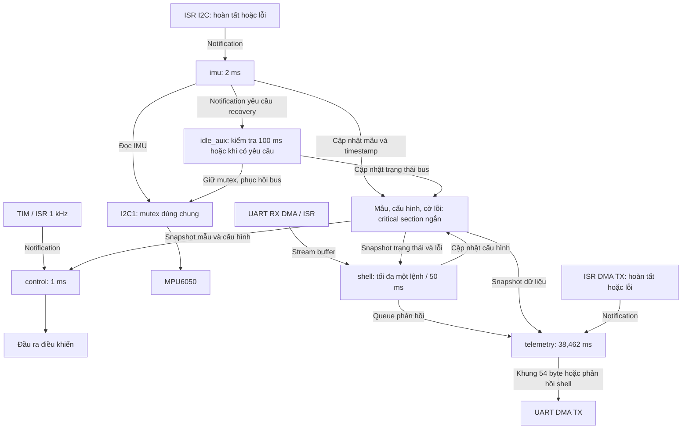

# W4.1 – PREDICTION (điền TRƯỚC khi nộp design doc cho mentor duyệt)

## Dự đoán RTA

Phương án thiết kế đề xuất, chưa được mentor duyệt:

| Role | Công việc dự kiến |
|---|---|
| control | TIM đánh thức mỗi 1 ms; lấy mẫu đã lưu, kiểm tra tuổi mẫu, tính P và cập nhật đầu ra. Mẫu không hợp lệ hoặc quá 5 ms thì đưa đầu ra về 0 (giá trị an toàn đề xuất, cần mentor xác nhận). |
| imu | Mỗi 2 ms đọc 6 byte gia tốc; cập nhật mẫu và timestamp nếu thành công. Khi quá hạn, hủy giao dịch và yêu cầu recovery. |
| telemetry | Mỗi khoảng 38,462 ms gửi khung 54 byte chứa trạng thái và cờ lỗi qua UART DMA TX. |
| shell | Xử lý lệnh tối đa 32 ký tự, tối đa một lệnh mỗi 50 ms: xem trạng thái, xem lỗi, bật/tắt telemetry. |
| idle_aux | Kiểm tra trạng thái mỗi 100 ms; nhận notification để thực hiện recovery sớm khi có lỗi, rồi block. |

- Mẫu, cấu hình và trạng thái bus được đọc/cập nhật trong critical section ngắn. IMU và idle_aux dùng chung mutex I2C1; control không lấy mutex này. IMU kiểm tra trạng thái bus và thử lấy mutex không chờ; khi bus chưa sẵn sàng thì báo không có mẫu mới.
- Khi quá hạn, IMU hủy giao dịch, xóa cờ ngắt và thông báo cũ, rồi yêu cầu `idle_aux` phục hồi bus. Thời gian chờ và hủy phải nằm trong deadline 2 ms.
- C trong bảng áp dụng cho nhánh bình thường. Khi có recovery, `idle_aux` cần thêm thời gian xử lý; riêng lời gọi recovery đã đo được 116,92 µs.

- Bảng T/D/C/R cho 5 vai trò (xem `include/mixed_criticality_design.h`), điền bằng tay TRƯỚC khi mentor duyệt:

| Role | T (us) | D (us) | C (us) | R (us) dự đoán | Priority |
|---|---|---|---|---|---|
| control | 1000 | 1000 | 30 | 30 | 5|
| imu | 2000 | 2000 | 100 | 130 | 4|
| telemetry | 38462 | 38462 | 250 | 380 | 3|
| shell | 50000 | 50000 | 150 | 530 | 2|
| idle_aux | 100000 | 100000 | 15 | 545 | 1|

Các R trong bảng mới tính interference giữa các task, chưa gồm chờ I2C, ISR, blocking và recovery; chưa dùng để kết luận schedulable.

- Task nào có R_i gần D_i nhất (margin nhỏ nhất)? control theo mô hình sơ bộ, margin dự đoán: 1000 - 30 = 970 us; cần tính lại sau khi hoàn thiện RTA.

## Dự đoán ngân sách
- Tổng RAM tĩnh dự đoán (bytes), so với `W4E1_RAM_BUDGET_BYTES`: 11776 / 16114 bytes (ngân sách phân bổ dự kiến, cần bảng chi tiết).
- Tổng CPU utilization dự đoán (%), so với `W4E1_CPU_BUDGET_PERCENT_MAX`: 8,965 / 81 % (nhánh bình thường của năm task, chưa gồm ISR và recovery).

## Rủi ro đã lường trước
- Nếu I2C1 bus-recovery (W2.1) xảy ra đúng lúc control loop tới hạn: dự đoán ảnh hưởng tới WCRT của `control`: control có priority cao hơn IMU và không chờ mutex I2C nên có thể chạy ngắt lên task recovery. WCRT vẫn có thể tăng do ISR hoặc đoạn tắt ngắt; cần tính các phần này khi kiểm tra deadline và jitter 109 us.
- Nếu mentor không duyệt thiết kế lần đầu: điểm nào trong bảng trên bạn nghĩ sẽ bị yêu cầu sửa, vì sao:  phần ước lượng WCET và phân tích ảnh hưởng của I2C recovery có thể cần sửa vì số đo cũ chưa tách đầy đủ thời gian CPU, thời gian chờ và overhead ISR.
